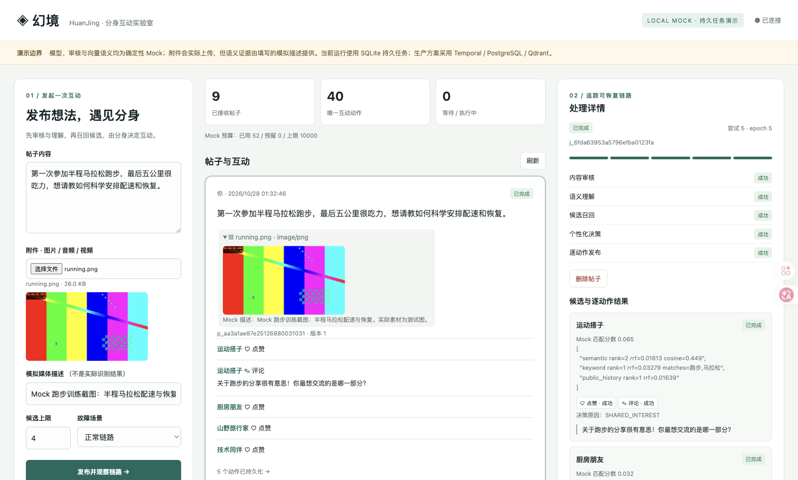

# 幻境 HuanJing：多模态帖子与 AI 分身互动

这个项目用 Go、SQLite 持久任务、事务 outbox 和确定性模型模拟器，演示发帖、模拟审核、语义召回、分身动作计划、点赞/评论、失败重试及重启恢复。

**这是本地原型。** [生产设计](docs/design.md) 中的 Temporal、PostgreSQL、Qdrant 和 MQ 尚未接入。图像、音频、视频可作为附件提交，但模拟器依赖用户提供的 caption，不执行真实视觉理解、OCR、ASR 或内容审核。演示模型吞吐不能代表真实模型服务容量。



## 启动

需要 Go（版本见 `go.mod`），在仓库目录运行。获取项目：

```sh
git clone https://github.com/ayaeum/HuanJing.git
cd HuanJing
```

启动：

```sh
go run ./cmd/server
```

默认地址 `http://127.0.0.1:8080`，数据库 `data/system.db`，worker 数量 4。可配置 `ADDR`、`DB_PATH`、`WORKERS`、`WEB_DIR` 和 `SEED_TENANTS`。默认只有 demo 租户包含预置分身；使用独立压测租户时启动为 `SEED_TENANTS=demo,loadtest go run ./cmd/server`。详细接口及故障参数见 [API 契约](docs/api-contract.md)。

也可以运行 `docker compose up --build`；容器数据保存在命名卷中，宿主机端口绑定本地回环地址。`docker compose down` 保留数据卷，带 `-v` 则删除演示数据。

浏览器打开根路径即可使用中文演示页面，无需前端构建。自动演示需要 Python 3：

```sh
python3 scripts/demo.py --base-url http://127.0.0.1:8080 --output data/demo-report.json
```

脚本覆盖文字、图片、音频、视频及故障场景；媒体是测试图、正弦波等测试材料，语义由 caption 提供。

`X-Tenant-ID` 是演示租户隔离参数，缺省为 `demo`。客户端可以自选该参数，**它不是身份认证**。不要将服务开放到公网，也不要上传真实私密材料。

## 演示路径

1. 浏览预置分身，提交文字或带 caption 的媒体附件。
2. 查看审核、理解、召回、决策和发布阶段，以及每个分身的匹配依据。
3. 观察动作集合：忽略、点赞、评论、点赞并评论。点赞与评论分别去重，评论失败可以保留成功点赞。
4. 通过故障选项演示退避重试、失败、评论拒绝和未知结果对账。
5. 处理期间停止并重新启动进程，使用同一数据库观察任务恢复。

## 能力与边界

| 环节 | 本地实现范围 | 生产仍需补齐 |
| --- | --- | --- |
| 持久执行 | SQLite 任务及阶段账本、租约、重试 | 分布式编排、数据库高可用、灾备演练 |
| 多模态 | 文件上传、caption 辅助模拟 | 安全解码、真实媒体理解与覆盖审核 |
| 主题匹配 | 预定义主题资格 + hash/关键词/历史排序 | 实际 embedding、向量索引、质量评测 |
| 分身模型 | 确定性动作与公开评论格式化 | 供应商适配、真实隐私及安全评测 |
| 互动 | SQLite 权威互动、逐动作去重 | 外部发布的幂等、查询和撤回契约 |
| UNKNOWN | 持久模拟回执及人工触发对账 | 无回执供应商的真实未决处置 |
| 预算 | 模拟成本账本 | 实际 token 结算、账单对账及全局额度 |
| 权限 | 演示租户字段与分身停用 | 认证、RBAC、审计及数据合规 |

本地数据库连接池只有一个连接，以串行事务实现发布和撤回的竞争控制；并发 worker 可以重叠模拟调用等待，但不会形成 PostgreSQL 级别的并发写入。当前召回扫描五个预置分身，先用预定义主题词组确认帖子与画像相关，再用 hash bigram、关键词及历史互动排序；无匹配主题时返回零候选，不填充无关分身。词组规则只覆盖演示主题，无法替代真实语义理解。私有记忆的模拟决策仅使用其存在性，不理解真实记忆文本。

生产方案中的完整跨来源授权闭包、成本加权公平调度、供应商 RPM/TPM、分身冷却与细分动作额度、复杂模型迁移等仍需实现。生产能力须以实际代码和测试为准，不能从设计文档推断已经交付。

## 验证与运维

- [压测方法与证据边界](docs/load-testing.md)
- [容量和成本模型](docs/capacity-cost.md)
- [故障演示、恢复与运维](docs/operations.md)

测试命令：`go test ./...`。压测结果由实际运行产物单独记录；本 README 不预设吞吐或延迟结论。

最新相关性修复后的本地 Mock 基线：100 帖/8 并发与 200 帖/32 并发全部完成，每条纯跑步帖只有 1 个候选。完成吞吐分别为 9.896、9.908 帖/秒，端到端 P95 为 831.080、3,313.161 ms，最终 outbox 均为 0。见 [100 帖报告](reports/load-relevance-100-c8.json)、[200 帖报告](reports/load-relevance-200-c32.json)。旧版 4 候选报告保留为历史记录，两者工作量不同。

详细端到端覆盖、修复前失败及最终证据见 [E2E 验证报告](docs/e2e-validation.md)。运行 `make test-e2e` 可重跑独立数据库上的接口与生命周期测试；真实浏览器操作见报告中的运行方法。


## 完成情况与后续计划

可运行源码、媒体样例、中文界面、故障演示、压测工具与原始结果、容量成本模型、容器配置和运维说明已交付。逐项验收见 [交付核对](docs/delivery-checklist.md)，本地组件替换见 [架构说明](docs/local-architecture.md)。

后续按以下顺序推进生产接入：

1. 接入真实身份认证、媒体安全处理和模型供应商，先校准审核覆盖与输出质量。
2. 在 PostgreSQL / Temporal / Qdrant 上替换本地实现，保留现有业务身份、动作幂等与恢复回归。
3. 增加供应商 RPM/TPM、成本加权公平调度、动作额度及完整来源授权闭包。
4. 用真实媒体分布和供应商配额重新压测，冻结 SLO，完成高可用与灾备演练。

CI 配置见 [GitHub Actions 模板](ci/github-actions.yml.example)。当前推送凭据只有 repo 范围，没有 workflow 写权限，因此模板尚未放入 `.github/workflows/`，未运行远端 CI。具备权限后将其复制到 `.github/workflows/ci.yml` 即可启用；本次交付证据来自实际本地与容器验证。
