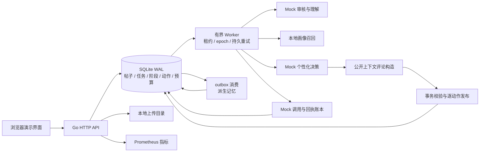
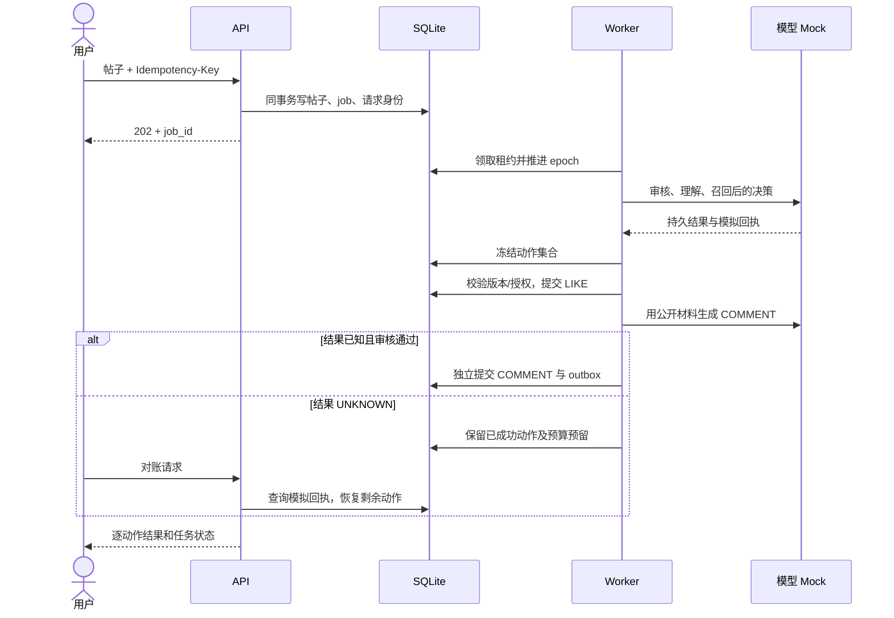

# 本地实现架构

本文件描述可运行版本的组件替换。目标设计见 [design.md](design.md)，原生可编辑画板保留在[飞书方案](https://feishu.cn/docx/GT2DdM2ioo939xxzjaFmFtsHyOh)。本地运行不依赖飞书。

SQLite 的单机事务承担最终校验与发布，进程内 Worker 执行持久阶段，数据库 outbox 承担事件交付。此实现验证应用协议，不提供 Temporal 的历史回放、PostgreSQL 的多节点部署或 Qdrant 的 ANN 性能。Mock 生成只模拟可重复的结果与故障，不代表真实模型理解、安全审核或推荐质量。
