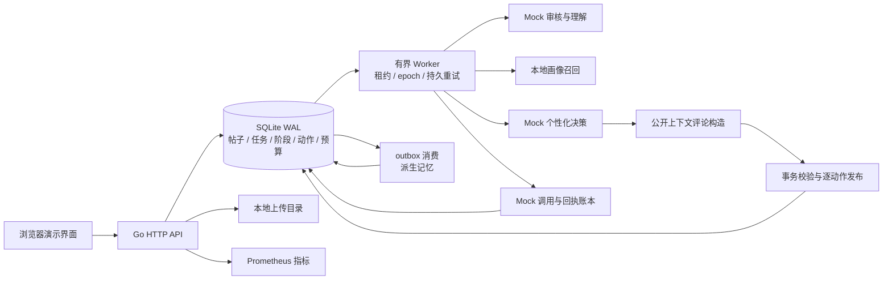
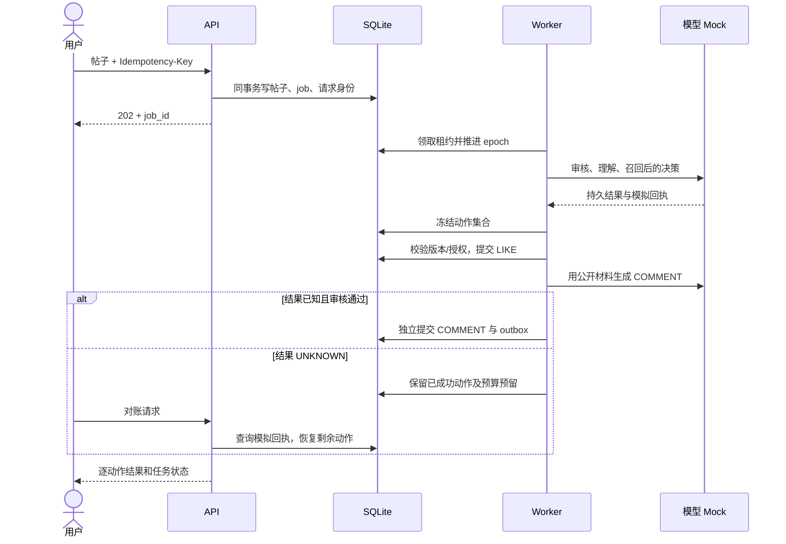

# 本地实现架构

本文件描述可运行版本的组件替换。目标设计见 [design.md](design.md)，原生可编辑画板保留在[飞书方案](https://feishu.cn/docx/GT2DdM2ioo939xxzjaFmFtsHyOh)。本地运行不依赖飞书。

SQLite 的单机事务承担最终校验与发布，进程内 Worker 执行持久阶段，数据库 outbox 承担事件交付。此实现验证应用协议，不提供 Temporal 的历史回放、PostgreSQL 的多节点部署或 Qdrant 的 ANN 性能。Mock 生成只模拟可重复的结果与故障，不代表真实模型理解、安全审核或推荐质量。

## 相关性与附件访问

召回先检查预定义主题词组是否同时覆盖帖子和公开画像，再对合格候选进行 RRF 排序。hash bigram 分数及历史互动只能调整合格候选的顺序。英文词使用词边界匹配；未知主题返回零候选。跨主题文本可召回多个对应画像。真实 embedding 与相关性评测仍待接入。

上传记录与帖子绑定历史保存在 upload_bindings；帖子新增/编辑触发器在同一事务保存引用。未绑定文件可预览；曾绑定文件需要至少一个未删除且当前仍引用该文件的帖子才能读取。编辑移除和删除最后一个父帖会关闭访问，多个父帖共享文件时保留有效引用。启动时迁移现有帖子引用；旧版本已丢弃的历史引用无法从当前表恢复。文件物理清理尚未实现。
